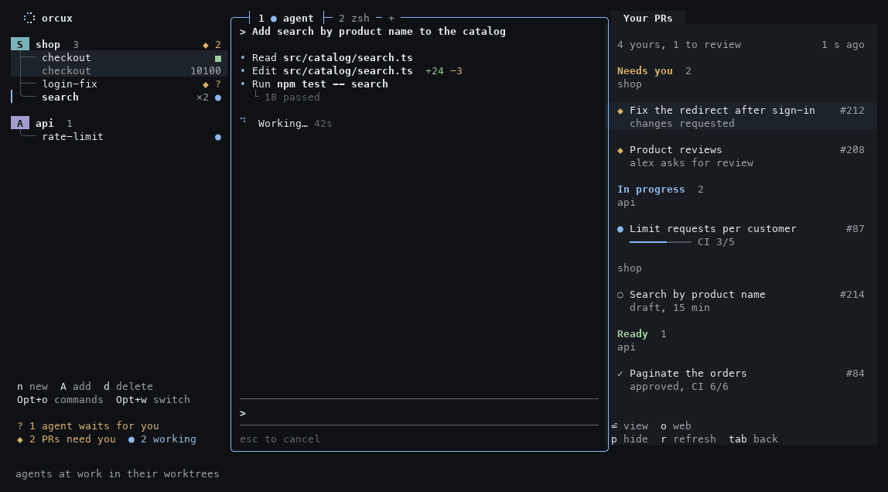
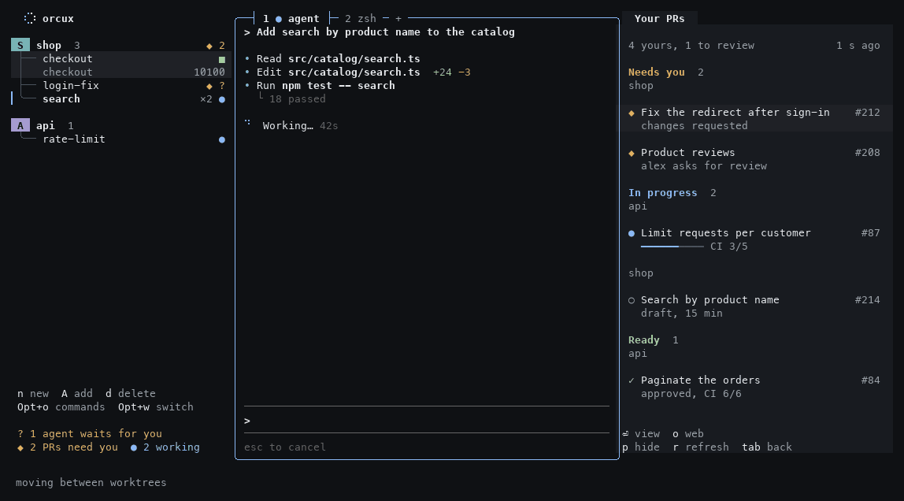
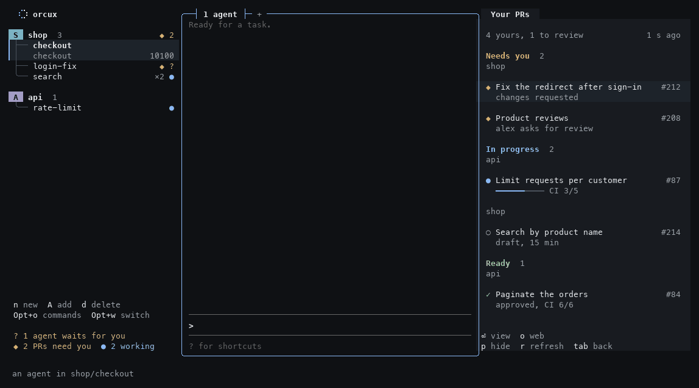

<p align="center"><picture><source media="(prefers-color-scheme: dark)" srcset="site/logo.svg"></picture></p>

<h1 align="center">orcux</h1>

<p align="center"><a href="README.md">English</a> · <b>Español</b></p>

Varios agentes de código a la vez, cada uno en su propio worktree de git. Ultra rápido, ultra ligero, en la terminal que ya usas.


- **Un worktree por tarea**: rama, carpeta, terminal y 100 puertos propios, con una tecla.
- **Mira quién te necesita**: trabajando `●`, pregunta `?`, ha fallado `!`, ha terminado `■`. Una tecla te lleva allí.
- **Los agentes siguen sin ti**: cierra orcux y vuelve.
- **Recoge el trabajo**: archivos y diffs, conflictos, merge, y tus pull requests al lado.
- **Rápido y ligero**: un binario de unos 2 MB, sin tmux.

| 10 worktrees, una terminal cada uno, en reposo | orcux | otra TUI (un multiplexor en Rust) | otra app (Electron) | diferencia |
| --- | --- | --- | --- | --- |
| memoria, todos sus procesos | 24 MB | 55 MB | ≈ 1,2 GB | 2,3× y ≈ 49× menos |
| CPU en reposo | 0,10 % | 0,60 % | 1,4 % | 6× y 14× menos |
| listar los worktrees desde la CLI | 20 ms | 55 ms | 171 ms | 2,8× y 8,6× más rápido |
| tamaño instalado | 2,0 MB | 22,5 MB | 773 MB | 11× y 380× menor |

Misma máquina, mismos 10 worktrees: [cómo, y con 50 terminales](docs/speed.md).

## Instalar

Pídeselo a tu agente de código:

```text
Install orcux from https://github.com/borjamrd/orcux with its install script (curl -fsSL https://raw.githubusercontent.com/borjamrd/orcux/master/packaging/install.sh | sh). Make sure ~/.local/bin is in my PATH, then run orcux doctor and tell me what it reports.
```

O hazlo tú:

```sh
curl -fsSL https://raw.githubusercontent.com/borjamrd/orcux/master/packaging/install.sh | sh
```

O con Homebrew (la versión 7 pide confiar antes en el tap):

```sh
brew trust --formula borjamrd/tap/orcux && brew install borjamrd/tap/orcux
```

macOS y Linux. Necesita git; [gh](https://cli.github.com) añade tus pull requests.

## Usar

```sh
cd tu-repo
orcux
```

`n` nuevo worktree · `⏎` abrirlo · `Opt+o` todos los comandos

## Más en movimiento

**Los agentes siguen sin ti**: cierra orcux, o la terminal, y vuelve a abrirlo: han seguido trabajando.



**Muévete entre worktrees**: `Opt+w` encuentra uno por su nombre o su pull request, `Opt+w ⏎` va y vuelve, `Opt+t` abre una pestaña con los puertos de su worktree.



**Subagentes**: un agente reparte partes de su tarea con `orcux run --parent`, cada una en un worktree hijo del suyo, y las espera.



Más en la [guía](docs/guide.md) (en inglés). [MIT](LICENSE).
