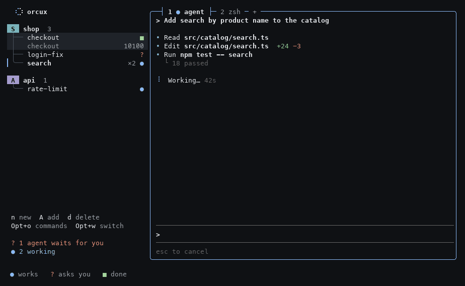

<h1>orcux</h1>

Git worktrees, ports and terminals for several coding agents at once, in the terminal you already use.



- **A worktree per task.** One key creates the branch, the folder, the terminal and a block of 100 ports of its own.
- **You see who needs you.** Claude Code agents tell when they work (`●`), ask or need permission (`?`), fail (`!`) or are done (`■`). Nothing in your settings is changed.
- **Agents go on without you.** tmux runs the terminals: close orcux, or lose the connection, and come back.
- **Your pull requests beside them**, read-only: whose turn it is, what fails, and a key to hand it to the agent.
- **A CLI that agents use too**: create worktrees, type into a terminal, read it.
- **Fast.** One binary of about 1 MB. With 50 terminals at rest it starts no processes and uses about 0.1 % of a core per pane.

## Install

You need [tmux](https://github.com/tmux/tmux) 3.6 and git 2.38, or later. tmux 3.3 to 3.5 should work, with lines between panes; it is not tested. [gh](https://cli.github.com) is optional: it shows your pull requests.

From the source:

```sh
cargo install --git https://github.com/borjamrd/orcux
orcux doctor   # checks what orcux needs
```

macOS and Linux.

## Start

```sh
cd your-repo
orcux repo add
orcux
```

Press `n` to create a worktree, `⏎` to open it, and start your agent there. `?` lists everything else.

| Key | |
| --- | --- |
| `n` / `N` | new worktree / new one from the selected one |
| `⏎` | open the selected worktree |
| `Opt+w` | switch worktree, by name or pull request |
| `Opt+t`, `Opt+a`, `Opt+d`, `Opt+q` | new, previous, next and close tab |
| `tab` | go to the pull requests |
| `q` | leave; the terminals stay alive |

## For agents and scripts

```sh
orcux new fix-login --cmd claude      # worktree, ports and terminal
orcux send fix-login "run the tests"  # types it, with Enter
orcux read fix-login 40               # the end of its terminal
orcux ls
orcux rm fix-login                    # keeps the branch
```

Several can run at once. `orcux help` lists every command.

## Ports

Worktrees share your computer, so two servers on port 3000 collide. Each terminal gets its own block:

| Variable | |
| --- | --- |
| `ORCUX_PORT` | the first of 100 ports: 10100, 10200… |
| `ORCUX_SLOT`, `ORCUX_ID` | the number and the name of the worktree |
| `COMPOSE_PROJECT_NAME` | so that Docker Compose keeps them apart |

Use them in your scripts: `vite --port $ORCUX_PORT`. Files that git ignores and you need in every worktree, such as `.env`, go in a `.worktreeinclude`.

## Languages

English and Spanish, after your system or with `orcux lang`.

## Development

```sh
cargo test
cargo test --release --test perf -- --ignored --nocapture   # what 50 terminals cost
```

Tests use a tmux server of their own, never yours.
